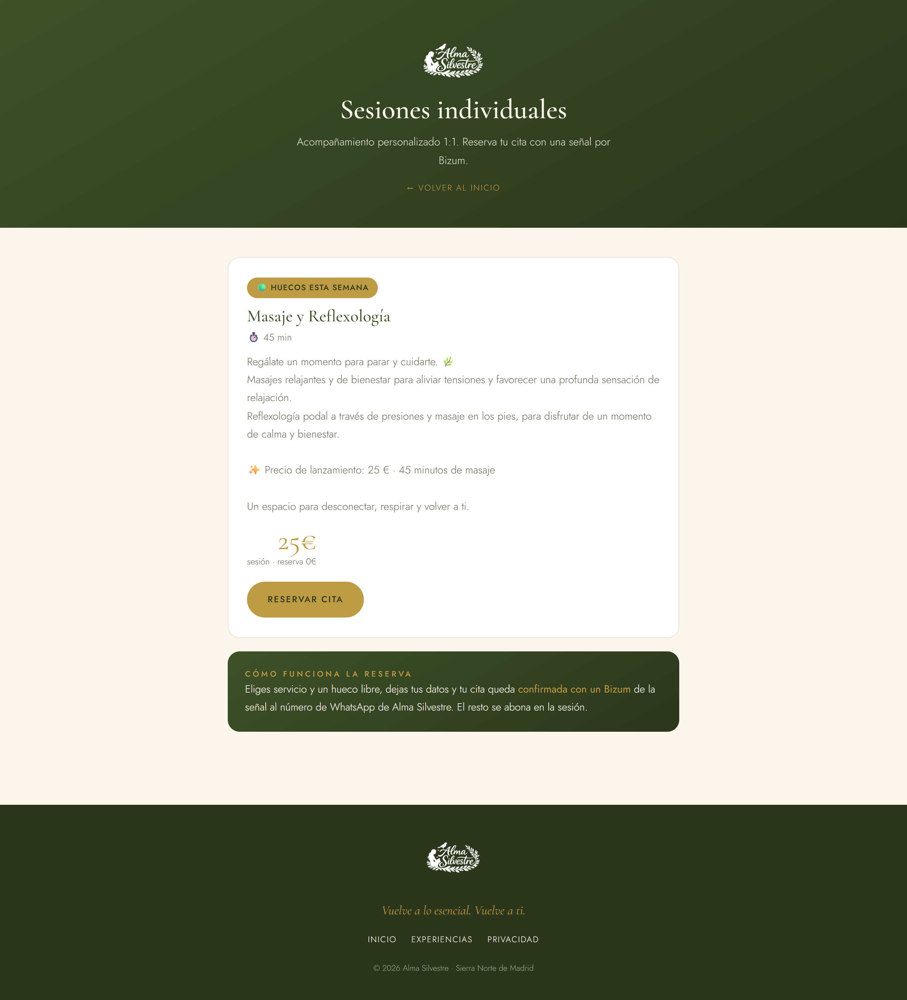
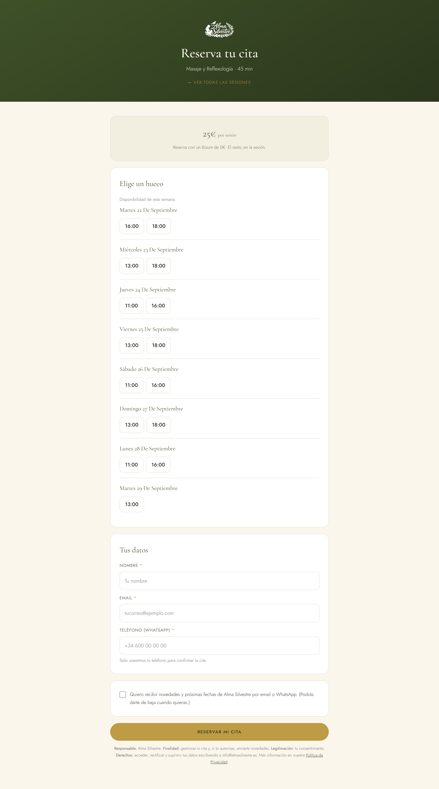
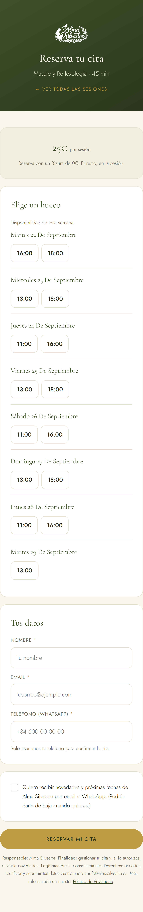
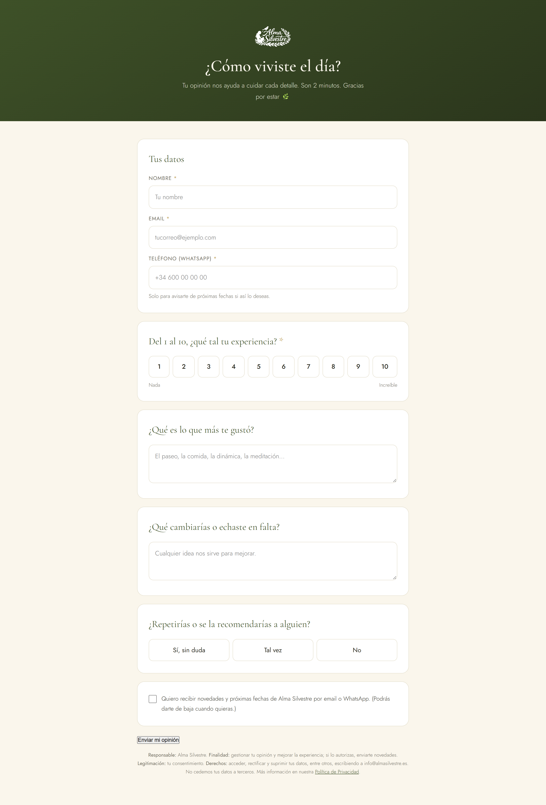
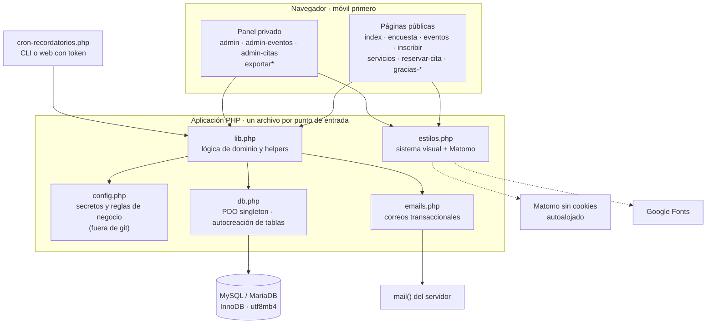
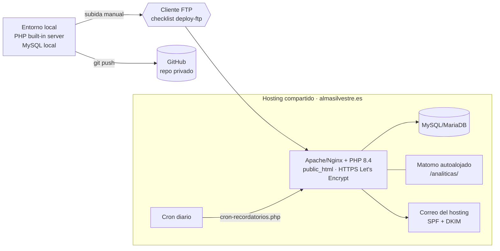
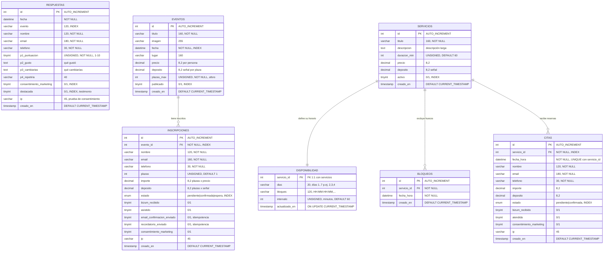

## Índice

0. [Ficha del proyecto](#0-ficha-del-proyecto)
1. [Descripción general del producto](#1-descripción-general-del-producto)
2. [Arquitectura del sistema](#2-arquitectura-del-sistema)
3. [Modelo de datos](#3-modelo-de-datos)
4. [Especificación de la API](#4-especificación-de-la-api)
5. [Historias de usuario](#5-historias-de-usuario)
6. [Tickets de trabajo](#6-tickets-de-trabajo)
7. [Pull requests](#7-pull-requests)

---

## 0. Ficha del proyecto

### **0.1. Tu nombre completo:**

Emilio Fernández Pérez

### **0.2. Nombre del proyecto:**

Alma Silvestre — Encuestas, Experiencias y Citas

### **0.3. Descripción breve del proyecto:**

Plataforma web para **Alma Silvestre**, un negocio artesanal de experiencias de bienestar en la naturaleza con base en **Buitrago de Lozoya** (Sierra Norte de Madrid). Cubre tres flujos de negocio sobre una misma base: **encuestas** de satisfacción post-experiencia con consentimiento de marketing, **experiencias grupales** publicables con inscripción, control de aforo, lista de espera y señal, y **citas individuales 1:1** reservables sobre un horario recurrente con capacidad de una persona por hueco. Incluye panel de administración, correos transaccionales de marca, cron de recordatorios y cumplimiento RGPD (analítica sin cookies, consentimiento explícito, política de privacidad).

### **0.4. URL del proyecto:**

**https://almasilvestre.es** — en producción sobre hosting compartido.

Páginas públicas accesibles sin credenciales: landing, catálogo de experiencias (`/eventos.php`), catálogo de servicios 1:1 (`/servicios.php`), encuesta (`/encuesta.php`) y política de privacidad.

El **panel de administración** (`/admin.php`) contiene datos personales de clientes reales: sus credenciales no se publican y se comparten de forma segura con el TA bajo petición. En la **Entrega 3** se aportará además evidencia de despliegue (capturas y/o vídeo del sistema funcionando, incluido el panel).

### 0.5. URL o archivo comprimido del repositorio

- **Repositorio de entrega (este fork, público):** https://github.com/emiliofdz1/AI4Devs-finalproject — rama `feature/entrega-1-emiliofdz1`. Contiene la documentación de las entregas.
- **Repositorio de código (privado):** `emiliofdz1/alma-silvestre-encuestas`. Es un proyecto de cliente real; el acceso se concede al TA (y al Líder de Programa si aplica) bajo petición, según la Opción A del enunciado.

---

## 1. Descripción general del producto

### **1.1. Objetivo:**

**El contexto.** Alma Silvestre organiza baños de bosque, experiencias grupales en la naturaleza y terapias individuales en la Sierra Norte de Madrid. Es un negocio de una sola persona: quien diseña las experiencias es también quien las imparte, las cobra y las gestiona.

**El problema.** La actividad se gestionaba por WhatsApp y cuaderno: apuntaba a mano quién venía a cada salida, cobraba sin registro, no sabía cuántas plazas quedaban hasta contar mensajes, y perdía las opiniones de los asistentes en cuanto la conversación se enterraba en el chat. Sin datos no hay decisiones: ni qué experiencia repetir, ni a quién avisar de la siguiente fecha.

**Qué resuelve el producto.**

1. **Mide la satisfacción** de quien ya vivió una experiencia con una encuesta breve, y capta de forma explícita el consentimiento para comunicaciones futuras.
2. **Vende plazas** de experiencias grupales, reteniéndolas con una señal (depósito) y evitando la sobreventa de la última plaza mediante control de aforo transaccional.
3. **Agenda sesiones individuales** 1:1 sobre un horario recurrente, con capacidad de una persona por hueco garantizada a nivel de base de datos.
4. **Automatiza la comunicación**: confirmaciones y recordatorios por email, sin intervención manual.
5. **Respeta la privacidad**: consentimiento explícito y separado, analítica sin cookies, política de privacidad y páginas sensibles no indexables.

**Para quién.**

| Perfil | Qué obtiene |
|---|---|
| **Cliente final** | Reservar una experiencia o una sesión 1:1 en dos minutos desde el móvil, sin llamar ni esperar respuesta en WhatsApp. |
| **Responsable del negocio** | Aforo, ingresos previstos, contactos con consentimiento y opiniones, en un panel y exportables a CSV. |
| **Gestoría / marketing** | Datos limpios y exportables, separando quién autorizó recibir novedades y quién no. |

### **1.2. Características y funcionalidades principales:**

**Encuestas post-experiencia**
- Formulario breve (puntuación 1-10, qué gustó, qué cambiarías, si repetiría) con datos de contacto y casilla de consentimiento de marketing separada del envío.
- Guardado validado con protección anti-CSRF; normalización del teléfono al formato internacional.
- Marcado de respuestas como *destacadas* para reutilizarlas como testimonios en la landing.

**Experiencias grupales**
- Listado público de experiencias publicadas, con datos estructurados JSON-LD para SEO.
- Inscripción con **control de aforo transaccional**: la plaza se decide dentro de una transacción con `SELECT … FOR UPDATE`, de modo que dos personas que pulsan a la vez no pueden comprar la misma última plaza.
- **Lista de espera automática**: si no quedan plazas, la inscripción se guarda en estado `espera` en lugar de rechazarse.
- Mensaje de escasez real (no inventado): muestra el número exacto de plazas restantes por debajo de un umbral configurable (`ESCASEZ_UMBRAL`, hoy 5).
- Señal por Bizum: importe y depósito calculados por número de plazas.
- Panel de administración: alta, edición y publicación de experiencias, gestión de inscritos y confirmación de pagos.
- Exportación CSV de inscritos, total o filtrada por consentimiento de marketing.

**Citas individuales 1:1**
- Catálogo de servicios activos con duración, precio y señal.
- Generación de huecos a partir de un **horario recurrente** por servicio (días de la semana, bloques horarios e intervalo), menos los huecos bloqueados manualmente y los ya reservados, dentro de una ventana pública de 7 días (`CITAS_DIAS_VISIBLES`).
- **Capacidad de 1 por hueco garantizada por la base de datos** (clave única `servicio_id + fecha_hora`): en una colisión de concurrencia el segundo cliente recibe "ese hueco acaba de reservarse" en lugar de una doble reserva.
- Panel: servicios, disponibilidad recurrente, bloqueos puntuales, citas y confirmación de pagos.
- Exportación CSV de citas.

**Comunicaciones**
- Correos transaccionales con la identidad visual de la marca: reserva pendiente, lista de espera, reserva confirmada, recordatorio de evento, cita pendiente, cita confirmada y aviso interno al negocio.
- Cron **idempotente** de recordatorios (marca `recordatorio_enviado`), ejecutable por CLI o por web protegido con token.
- Un fallo de envío de correo nunca invalida la reserva: el envío va en `try/catch` posterior a la escritura en base de datos.

**Administración, SEO y legal**
- Login de administración con comparación en tiempo constante, límite de intentos y regeneración de sesión.
- Landing de marca con testimonios reales, estadísticas, FAQs y llamadas a la acción.
- Sitemap XML, `robots.txt`, metadatos y JSON-LD de negocio local.
- Política de privacidad RGPD y analítica Matomo **sin cookies** (no requiere banner de consentimiento).

### **1.3. Diseño y experiencia de usuario:**

El producto se diseñó **mobile-first**: la mayoría del tráfico llega desde un enlace de WhatsApp o Instagram en el móvil, y el objetivo es que reservar cueste menos que escribir un mensaje.

#### Capturas del sistema en producción

Capturas tomadas de https://almasilvestre.es (páginas públicas, sin datos de clientes).

**Landing de marca** — hero, la experiencia, el equipo, terapias individuales, próxima experiencia con precio, testimonios reales, FAQ y contacto.


**Catálogo de sesiones individuales** — servicios activos con duración, precio y acceso a la reserva.



**Reserva de sesión 1:1 — el flujo principal.** Es la pantalla que concentra las decisiones de producto: huecos libres calculados al vuelo y agrupados por día, precio y señal, datos mínimos, consentimiento de marketing como casilla **independiente** del envío, y la cláusula RGPD (responsable, finalidad, legitimación, derechos) al pie del formulario.



**La misma pantalla en móvil**, que es el contexto real de uso:



**Encuesta post-experiencia** — cuatro preguntas, sin registro ni login.



**Recorrido 1 — Reservar una sesión individual (flujo principal end-to-end)**

```
index.php            Landing de marca → CTA "Reservar sesión"
   ↓
servicios.php        Catálogo de servicios activos (duración, precio, señal)
   ↓
reservar-cita.php    Huecos libres agrupados por día · selección de hora
   ↓ (POST)          Datos + consentimiento · validación + anti-CSRF
gracias-cita.php     Instrucciones de Bizum · estado de la reserva por sesión PHP
   ↓
Email               Cliente: cita pendiente con instrucciones · Negocio: aviso interno
   ↓
admin-citas.php     El negocio marca el Bizum recibido → cita confirmada + email
```

**Recorrido 2 — Inscribirse a una experiencia grupal**

`eventos.php` (listado con escasez real) → `inscribir.php` (plazas, datos, consentimiento) → `gracias-reserva.php`. Si el aforo está completo, la misma pantalla cambia el mensaje y el botón a "Apuntarme a la lista de espera" sin que el usuario tenga que entender el cambio de estado.

**Recorrido 3 — Encuesta post-experiencia**

Enlace enviado tras la actividad → `encuesta.php` (4 preguntas, sin registro ni login) → `guardar.php` muestra el agradecimiento con accesos a WhatsApp e Instagram.

**Recorrido 4 — Administración**

`admin.php` (login) → panel con respuestas, inscripciones y citas → confirmación de pagos y exportaciones CSV.

**Decisiones de experiencia y de marca**

- **Sistema visual centralizado** en `estilos.php`: una paleta *forest/gold* y tres tipografías (Parisienne para la firma, Cormorant Garamond para titulares, Jost para texto) definidas como variables CSS y reutilizadas también en los correos, para que el email se lea como la web.
- **Sin JavaScript de framework**: los formularios funcionan con HTML nativo. La página carga en conexiones móviles débiles, que es la realidad del entorno rural donde opera el negocio.
- **Estado por sesión, no por URL**: las pantallas de "gracias" leen el identificador de la reserva desde la sesión PHP, no desde la query string, para no filtrar datos ni permitir enumerar reservas ajenas cambiando un número.
- **Escasez honesta**: el mensaje de urgencia muestra plazas reales (`¡Última plaza disponible!`, `¡Solo quedan 3 plazas!`), nunca una cuenta inventada.
- **Consentimiento desacoplado**: la casilla de marketing es independiente del envío del formulario; se puede reservar sin aceptar comunicaciones.

> El **panel de administración** no se muestra aquí porque contiene datos personales de clientes reales. Se aportará en la **Entrega 3** mediante vídeo con datos de prueba, junto con la evidencia de despliegue.

### **1.4. Instrucciones de instalación:**

**Requisitos**

- **PHP 8.4** (versión de producción; el código es compatible desde 8.0) con extensión PDO MySQL y función `mail()` disponible.
- MySQL 5.7+ / MariaDB 10.3+ con soporte InnoDB (obligatorio: el control de aforo usa transacciones y bloqueo de filas).
- Acceso FTP o gestor de archivos, y posibilidad de programar una tarea cron. Cualquier hosting compartido estándar cumple.
- Sin Composer, sin npm, sin paso de build: no hay dependencias que instalar.

**Pasos**

1. **Obtener el código**

   ```bash
   git clone <url-del-repositorio-privado> alma-silvestre
   cd alma-silvestre
   ```

2. **Crear la base de datos** (vacía; el esquema se crea solo)

   ```sql
   CREATE DATABASE alma_silvestre CHARACTER SET utf8mb4 COLLATE utf8mb4_unicode_ci;
   CREATE USER 'alma'@'localhost' IDENTIFIED BY 'una-clave-larga';
   GRANT ALL PRIVILEGES ON alma_silvestre.* TO 'alma'@'localhost';
   ```

3. **Crear `config.php`** en la raíz. Es el **único** archivo que se edita y está excluido de git (`.gitignore`) porque contiene secretos. Los valores de marca y de negocio son los reales del proyecto; **los cuatro secretos aparecen como marcadores de posición y nunca se versionan**:

   ```php
   <?php
   // --- Base de datos --- (valores reales solo en el servidor)
   const DB_HOST    = 'TU_HOST_DE_BD';
   const DB_NOMBRE  = 'TU_BASE_DE_DATOS';
   const DB_USUARIO = 'TU_USUARIO';
   const DB_CLAVE   = 'TU_CLAVE';

   // --- Acceso al panel ---
   const ADMIN_PASSWORD = 'CLAVE_LARGA_DEL_PANEL';

   // --- Marca ---
   const MARCA_NOMBRE    = 'Alma Silvestre';
   const MARCA_WHATSAPP  = '34XXXXXXXXX';   // prefijo + número, sin + ni espacios
   const MARCA_INSTAGRAM = 'almasilvestremadrid';
   const MARCA_EMAIL     = 'info@almasilvestre.es';
   const MARCA_WEB       = 'https://almasilvestre.es';
   const MARCA_EMAIL_RESERVAS = 'reservas@almasilvestre.es';
   const PREFIJO_PAIS    = '+34';

   // --- Reglas de negocio (valores reales en producción) ---
   const ESCASEZ_UMBRAL          = 5;   // plazas por debajo de las cuales se muestra urgencia
   const CITAS_DIAS_VISIBLES     = 7;   // ventana pública de huecos 1:1
   const CITA_HUECOS_OCUPADOS    = 1;   // capacidad por hueco
   const RECORDATORIO_DIAS_ANTES = 2;   // antelación del recordatorio de evento
   const CRON_TOKEN              = 'CADENA_ALEATORIA_LARGA';

   // --- Logo y SEO local ---
   const MARCA_LOGO_ARCHIVO = 'logo.png';
   const MARCA_LOGO_URL     = '';
   const SEO_LOCALIDAD = 'Buitrago de Lozoya';
   const SEO_REGION    = 'Comunidad de Madrid';
   const SEO_AREA      = 'Sierra Norte de Madrid';
   const SEO_OG_IMAGEN = '';

   // --- Analítica (opcional; vacío la desactiva) ---
   const MATOMO_URL     = 'https://almasilvestre.es/analiticas/';  // con barra final
   const MATOMO_SITE_ID = '1';
   ```

4. **Subir los archivos** a `public_html` (o `www`) del hosting, por FTP o por el gestor de archivos del panel, respetando la raíz del proyecto. En local basta con `php -S localhost:8000`.

5. **Primer arranque:** abrir cualquier página. `db.php` crea las siete tablas automáticamente (`CREATE TABLE IF NOT EXISTS`). No hay migraciones que ejecutar. `schema.sql` queda como referencia y documenta los `ALTER TABLE` necesarios para instalaciones anteriores.

6. **Datos de partida (opcional):** `seed-masaje-desconexion.sql` crea un servicio 1:1 de ejemplo con su disponibilidad. Las experiencias y servicios se dan de alta desde el panel (`admin-eventos.php`, `admin-citas.php`).

7. **Programar el cron de recordatorios** (una vez al día):

   ```bash
   # Por CLI
   0 9 * * * php /ruta/al/proyecto/cron-recordatorios.php

   # O por web, si el hosting no da acceso a CLI
   0 9 * * * curl -s "https://tu-dominio/cron-recordatorios.php?token=CRON_TOKEN"
   ```

8. **Correo transaccional.** Crear el buzón o alias `reservas@` en el panel del hosting y configurar **SPF** (registro TXT que autorice al servidor de envío) y **DKIM** en el panel de correo. Sin ello, los correos de confirmación acaban en spam. Si el hosting limita `mail()`, se puede pasar a envío SMTP autenticado.

9. **Comprobaciones posteriores:**
   - Acceder a `admin.php` con la contraseña configurada.
   - Verificar que `config.php` **no** es accesible por HTTP.
   - Verificar que `uploads/` y la carpeta de analítica no están expuestos ni versionados.
   - **Borrar `test_conexion.php` del servidor** una vez la conexión funciona: expone información de la base de datos.
   - Activar HTTPS en el dominio (Let's Encrypt, gratuito en la práctica totalidad de hostings).

---

## 2. Arquitectura del Sistema

### **2.1. Diagrama de arquitectura:**



**Patrón: monolito modular por inclusión, sin framework.** Cada archivo `.php` de la raíz es un punto de entrada HTTP que compone siempre la misma cadena: configuración → lógica y helpers → conexión de datos → estilos → salida HTML. No hay router, ni contenedor de dependencias, ni capa de plantillas: `require_once` hace de sistema de módulos y el propio servidor web hace de router.

**Por qué esta arquitectura.** La restricción real del proyecto es el entorno de despliegue: hosting compartido barato, sin acceso a consola de despliegue, sin Docker, sin proceso de build, gestionado a futuro por alguien que no es desarrollador. Un framework moderno (Laravel, Symfony) habría exigido Composer, permisos de escritura en cachés, comandos de consola y una actualización periódica que nadie va a ejecutar. La decisión fue **optimizar para la supervivencia del proyecto sin desarrollador**, no para la comodidad durante el desarrollo.

**Beneficios**

- **Despliegue trivial e irrompible:** copiar archivos por FTP. No hay build que falle ni dependencias que se desactualicen.
- **Cero superficie de dependencias:** no hay `composer.json` ni `package.json`, por tanto no hay vulnerabilidades heredadas de terceros ni actualizaciones urgentes.
- **Portabilidad total:** funciona en cualquier hosting con PHP y MySQL, que es el mínimo común denominador del mercado.
- **Legibilidad directa:** un flujo se lee de arriba abajo en un solo archivo, sin saltar entre capas de abstracción.

**Sacrificios asumidos (y su contrapartida)**

| Déficit | Consecuencia real | Contrapartida aplicada |
|---|---|---|
| Sin ORM | Cada consulta se escribe a mano | Todas van preparadas vía PDO; la lógica de datos está centralizada en `lib.php`, no dispersa por las páginas |
| Sin router | La URL es el nombre del archivo | URLs legibles y estables; SEO controlado con `sitemap.php` |
| Sin motor de plantillas | HTML y PHP conviven en el mismo archivo | Todo lo que se imprime pasa por `esc()`; los estilos están centralizados |
| Sin suite de tests (aún) | La regresión se detecta a mano | Verificación manual documentada + auditoría con skill propia; suite prevista para la Entrega 3 |
| Escalabilidad vertical | Un solo servidor | El volumen del negocio (decenas de reservas al mes) está tres órdenes de magnitud por debajo del límite |

### **2.2. Descripción de componentes principales:**

| Componente | Tecnología | Responsabilidad |
|---|---|---|
| **Páginas públicas** (`index`, `encuesta`, `eventos`, `inscribir`, `servicios`, `reservar-cita`, `gracias-*`) | PHP 8 + HTML | Puntos de entrada HTTP. Validan la entrada, invocan la lógica de dominio y renderizan. Ninguna habla con la base de datos directamente. |
| **Panel de administración** (`admin`, `admin-eventos`, `admin-citas`) | PHP 8 + HTML | Login, gestión de experiencias, servicios, disponibilidad, bloqueos y confirmación de pagos. |
| **Exportadores** (`exportar`, `exportar-inscritos`, `exportar-citas`) | PHP 8 → CSV | Descargas filtrables. Neutralizan la inyección de fórmulas en CSV y respetan el filtro de consentimiento RGPD. |
| **`lib.php`** | PHP 8 | Núcleo de dominio (~1.000 líneas): aforo, estados de reserva, generación de huecos, CSRF, sesión de administración, sanitización, normalización de teléfonos. Es la única capa que consulta la base de datos. |
| **`db.php`** | PDO | Conexión singleton con `ERRMODE_EXCEPTION`, `FETCH_ASSOC`, `EMULATE_PREPARES=false` y `utf8mb4`. Autocreación del esquema al primer arranque. |
| **`emails.php`** | `mail()` nativo, multipart texto+HTML | Siete correos transaccionales con la identidad visual de la marca. Aislado del resto: un fallo de envío no rompe la reserva. |
| **`estilos.php`** | CSS con variables + Matomo | Sistema visual único (paleta, tipografías, componentes) y etiqueta de analítica sin cookies. Se incluye en todas las páginas. |
| **`config.php`** | Constantes PHP | Secretos y reglas de negocio parametrizadas. Excluido de git. Único archivo que edita quien instala. |
| **`cron-recordatorios.php`** | PHP CLI / HTTP con token | Envía recordatorios de evento de forma idempotente, marcando `recordatorio_enviado`. |
| **Base de datos** | MySQL/MariaDB InnoDB `utf8mb4_unicode_ci` | Siete tablas. InnoDB es requisito, no preferencia: el control de aforo depende de transacciones y bloqueo de filas. |

### **2.3. Descripción de alto nivel del proyecto y estructura de ficheros**

```
alma-silvestre/
├── index.php                  Landing de marca (testimonios, estadísticas, FAQ, CTA)
│
├── encuesta.php               Formulario de satisfacción post-experiencia
├── guardar.php                Recepción y guardado de la encuesta
│
├── eventos.php                Listado público de experiencias
├── inscribir.php              Inscripción con aforo y lista de espera
├── gracias-reserva.php        Confirmación de inscripción
│
├── servicios.php              Catálogo de servicios 1:1
├── reservar-cita.php          Selección de hueco y reserva
├── gracias-cita.php           Confirmación de cita
│
├── admin.php                  Login + panel principal
├── admin-eventos.php          CRUD de experiencias e inscritos
├── admin-citas.php            Servicios, disponibilidad, bloqueos y citas
├── exportar.php               CSV de respuestas de encuesta
├── exportar-inscritos.php     CSV de inscritos (filtro de consentimiento)
├── exportar-citas.php         CSV de citas
│
├── config.php                 [git-ignored] Secretos y reglas de negocio
├── db.php                     Conexión PDO + autocreación de tablas
├── lib.php                    Lógica de dominio y helpers
├── emails.php                 Correos transaccionales
├── estilos.php                Sistema visual + Matomo
├── cron-recordatorios.php     Recordatorios idempotentes
│
├── schema.sql                 Referencia del modelo de datos y migraciones
├── seed-masaje-desconexion.sql  Datos de ejemplo
│
├── politica-privacidad.php    RGPD
├── sitemap.php / robots.txt   SEO
│
├── uploads/                   [git-ignored] Imágenes subidas desde el panel
├── stats/                     [git-ignored] Matomo autoalojado (servido en /analiticas/)
│
├── openspec/                  Gestión de cambios especificada (10 propuestas)
│   ├── specs/                 Capacidades del producto ya especificadas
│   └── changes/               Propuestas: proposal.md · design.md · tasks.md
│
├── docs/                      Documentación interna extendida
└── .claude/                   Skills, comandos y reglas de trabajo con IA
    ├── skills/                marca · db-tabla · seguridad-php · deploy-ftp
    └── commands/opsx/         Flujo OpenSpec
```

**El patrón organizativo es "un archivo por caso de uso HTTP"**: la raíz es plana a propósito, porque el nombre del archivo *es* la URL. Las carpetas solo existen para lo que no se sirve por HTTP (documentación, especificaciones, configuración de herramientas) o para lo que se excluye del repositorio (subidas, analítica).

Dos carpetas merecen atención porque no son habituales en un proyecto PHP:

- **`openspec/`** — el cambio se especifica antes de codificarse. `specs/` guarda las capacidades del producto en formato requisito + escenario; `changes/` guarda cada mejora propuesta con su justificación, sus decisiones técnicas y su lista de tareas. Diez propuestas están documentadas y pendientes de implementar.
- **`.claude/`** — las convenciones del proyecto viven como *skills* ejecutables por el asistente de IA (crear una página respetando la marca, añadir una tabla siguiendo el patrón, auditar seguridad, desplegar por FTP), no solo como documentación que nadie lee.

### **2.4. Infraestructura y despliegue**



**Infraestructura.** Un único hosting compartido (plan básico) sirviendo el dominio `almasilvestre.es` con **PHP 8.4**, una base de datos MySQL/MariaDB, una instancia de **Matomo autoalojada en el mismo dominio** (`/analiticas/`), correo del propio hosting con SPF y DKIM configurados para el remitente `reservas@almasilvestre.es`, HTTPS por Let's Encrypt y una tarea cron diaria. Sin contenedores, sin balanceador, sin CDN propia. El coste total de operación es el de un plan de hosting compartido, que es lo que el negocio puede sostener.

**Proceso de despliegue.**

1. Desarrollo y prueba en local (`php -S localhost:8000` + MySQL local).
2. Commit y push al repositorio privado.
3. Auditoría previa con la skill `seguridad-php` (sustituye al linter: el entorno de desarrollo no tiene PHP CLI).
4. Checklist guiado de la skill `deploy-ftp`: verificar que `config.php` del servidor **no** se sobrescribe con el local, que `uploads/` y `stats/` no se tocan, y qué archivos han cambiado realmente.
5. Subida por FTP de los archivos modificados a `public_html`.
6. Verificación en producción: página pública, un formulario, acceso al panel.
7. Si el cambio toca el esquema: ejecutar el `ALTER TABLE` documentado en `schema.sql` antes de subir el código.
8. En la primera instalación, borrar `test_conexion.php` del servidor en cuanto la conexión funciona (expone información de la base de datos).

**Por qué no hay CI/CD.** El hosting no expone un endpoint de despliegue ni acceso SSH en el plan contratado; montar un pipeline exigiría cambiar de proveedor y elevar el coste recurrente para un proyecto cuyo ritmo de cambio es de pocos despliegues al mes. La mitigación es que el proceso manual está **escrito como checklist ejecutable** (`deploy-ftp`), no confiado a la memoria.

### **2.5. Seguridad**

| Práctica | Implementación | Dónde |
|---|---|---|
| **Prevención de inyección SQL** | Todas las consultas usan sentencias preparadas de PDO con `EMULATE_PREPARES=false`, de modo que la separación entre sentencia y datos la hace el servidor de base de datos, no una interpolación de cadenas en PHP. No hay concatenación de entrada de usuario en ninguna consulta. | `db.php`, `lib.php` |
| **Prevención de XSS** | Toda salida se imprime a través del helper `esc()` (`htmlspecialchars` con `ENT_QUOTES` y UTF-8), incluidos los valores que se devuelven a los formularios tras un error de validación. | Todas las páginas |
| **Protección anti-CSRF** | Todos los formularios que escriben llevan un token de sesión verificado con `csrf_check()`; un token ausente o incorrecto aborta la operación y redirige con error, sin tocar la base de datos. | `lib.php`, formularios públicos y de panel |
| **Autenticación del panel** | Comparación de contraseña en **tiempo constante** con `hash_equals` (evita ataques de temporización), **límite de intentos** por sesión frente a fuerza bruta y **regeneración del identificador de sesión** tras autenticar (evita fijación de sesión). | `lib.php`, `admin.php` |
| **No filtración por URL** | Las pantallas de confirmación leen el identificador de la reserva desde la **sesión PHP**, nunca desde la query string: no se pueden enumerar reservas ajenas cambiando un número en la URL. | `gracias-cita.php`, `gracias-reserva.php` |
| **Integridad frente a concurrencia** | El aforo se decide en una transacción con `SELECT … FOR UPDATE`; las citas se protegen con una clave única `(servicio_id, fecha_hora)` y el error `23000` se traduce a un mensaje de usuario. La base de datos, no la aplicación, es la autoridad final. | `lib.php` |
| **Inyección de fórmulas en CSV** | Los valores exportados que empiezan por `=`, `+`, `-` o `@` se neutralizan antes de escribirse, para que abrir el CSV en Excel no ejecute contenido introducido por un usuario. | `exportar*.php` |
| **Gestión de secretos** | Credenciales, contraseña de panel y token del cron viven en `config.php`, excluido del control de versiones. El repositorio nunca ha contenido secretos. | `config.php`, `.gitignore` |
| **Protección del cron por web** | La ejecución HTTP del cron exige un token largo (`CRON_TOKEN`); sin él, no se ejecuta. | `cron-recordatorios.php` |
| **RGPD y minimización** | Consentimiento de marketing explícito, separado y opcional, almacenado junto a la IP como prueba; las exportaciones de marketing filtran por `consentimiento_marketing = 1`; política de privacidad con responsable, finalidad, legitimación y derechos en cada formulario. | Formularios, `exportar*.php`, `politica-privacidad.php` |
| **Analítica sin cookies** | Matomo autoalojado configurado sin cookies: no requiere banner de consentimiento y no cede datos a terceros. | `estilos.php` |
| **Control de indexación** | Las páginas con datos o sin valor de búsqueda (`encuesta`, `inscribir`, `reservar-cita`, `gracias-*`, panel) llevan `noindex`; `sitemap.php` solo publica las indexables. | Cabeceras de página, `robots.txt` |

### **2.6. Tests**

**Estado real en la Entrega 1: no existe suite de tests automatizados.** Se declara explícitamente en lugar de presentar un plan como si estuviera ejecutado. El entorno de desarrollo no dispone de PHP CLI local, lo que impide ejecutar PHPUnit en la máquina de trabajo; resolver esa limitación forma parte del alcance de la Entrega 3.

**Qué sí se verifica hoy, y cómo:**

1. **Auditoría estática asistida** — la skill `seguridad-php` recorre las páginas buscando consultas sin preparar, salida sin escapar, formularios sin token CSRF, fallos de control de indexación y filtraciones de datos personales. Sustituye funcionalmente al linter ausente y se ejecuta antes de cada despliegue.
2. **Pruebas manuales de los flujos críticos**, ejecutadas sobre el checklist de despliegue:
   - Encuesta: envío válido, email inválido, puntuación fuera de rango (1-10), token CSRF caducado.
   - Inscripción: aforo con plazas, **última plaza**, aforo completo → lista de espera, número de plazas mayor que el disponible.
   - Citas: hueco libre, hueco ya reservado, hueco fuera de la ventana pública, servicio inactivo.
   - Correos: recepción de las siete plantillas y comprobación de que un fallo de envío no invalida la reserva guardada.
   - Cron: doble ejecución el mismo día → no duplica recordatorios (idempotencia verificada sobre `recordatorio_enviado`).
3. **Verificación de concurrencia** — dos reservas simultáneas sobre el mismo hueco 1:1: la segunda recibe "ese hueco acaba de reservarse" y no se crea una doble cita (garantía de la clave única, no del código de aplicación).

**Plan para la Entrega 3**

| Nivel | Alcance previsto |
|---|---|
| **Unitarios** | Funciones puras de `lib.php`: `tel_normalizar`, `mensaje_escasez`, `precio_fmt`, generación de huecos a partir del horario recurrente (días, bloques, intervalo, bloqueos). |
| **Integración** | `crear_inscripcion` y `crear_cita` contra una base de datos de prueba: estados `pendiente`/`espera`, cálculo de importe y depósito, colisión en la clave única, rollback ante error. |
| **End-to-end** | Flujo principal completo: catálogo → selección de hueco → reserva → pantalla de gracias → registro en base de datos, incluida la verificación del token CSRF. |

---

## 3. Modelo de Datos

### **3.1. Diagrama del modelo de datos:**



`RESPUESTAS` es deliberadamente **independiente**: guarda el nombre del evento como texto libre, no como clave foránea. La razón es de negocio, no técnica — se envían encuestas de actividades que nunca se publicaron como evento en la plataforma (talleres puntuales, colaboraciones), y una relación obligatoria habría impedido registrarlas.

> **Nota sobre integridad referencial.** Las relaciones son **lógicas**: el esquema declara los índices pero **no** restricciones `FOREIGN KEY`. Fue una decisión consciente para no depender del motor ni del orden de creación de tablas en la autocreación del esquema en hosting compartido; la integridad se mantiene en la capa de aplicación (`lib.php` valida la existencia y el estado del evento o servicio antes de insertar). El coste asumido es que un borrado manual en base de datos podría dejar filas huérfanas. Añadir las restricciones está anotado como deuda técnica.

### **3.2. Descripción de entidades principales:**

#### `respuestas` — Encuestas de satisfacción

| Atributo | Tipo | Restricciones | Descripción |
|---|---|---|---|
| `id` | `INT` | **PK**, auto-incremental | Identificador |
| `fecha` | `DATETIME` | `NOT NULL` | Fecha declarada de la experiencia valorada |
| `evento` | `VARCHAR(120)` | índice `idx_evento` | Nombre de la actividad, texto libre (sin FK, ver nota anterior) |
| `nombre` | `VARCHAR(120)` | `NOT NULL` | Dato personal |
| `email` | `VARCHAR(180)` | `NOT NULL`, validado con `FILTER_VALIDATE_EMAIL` | Dato personal |
| `telefono` | `VARCHAR(30)` | `NOT NULL`, normalizado a formato internacional | Dato personal (WhatsApp) |
| `p1_puntuacion` | `TINYINT UNSIGNED` | `NOT NULL`, validado 1-10 en aplicación | Satisfacción global |
| `p2_gusto` | `TEXT` | — | Qué gustó |
| `p3_cambiarias` | `TEXT` | — | Qué cambiarías |
| `p4_repetiria` | `VARCHAR(40)` | — | Si repetiría |
| `consentimiento_marketing` | `TINYINT(1)` | `DEFAULT 0`, índice `idx_consent` | Base legal de las comunicaciones; filtra las exportaciones |
| `destacada` | `TINYINT(1)` | `DEFAULT 0`, índice `idx_destacada` | Marca la respuesta para usarla como testimonio público |
| `ip` | `VARCHAR(45)` | — | Trazabilidad del consentimiento (IPv6 cabe en 45) |
| `creado_en` | `TIMESTAMP` | `DEFAULT CURRENT_TIMESTAMP` | Alta real en el sistema |

#### `eventos` — Experiencias grupales

| Atributo | Tipo | Restricciones | Descripción |
|---|---|---|---|
| `id` | `INT` | **PK**, auto-incremental | Identificador |
| `titulo` | `VARCHAR(160)` | `NOT NULL` | Nombre público |
| `imagen` | `VARCHAR(255)` | — | Ruta relativa en `uploads/` |
| `fecha` | `DATETIME` | `NOT NULL`, índice `idx_fecha` | Fecha y hora de celebración |
| `lugar` | `VARCHAR(160)` | — | Punto de encuentro |
| `precio` | `DECIMAL(8,2)` | `DEFAULT 0` | Precio por persona (decimal exacto, nunca flotante, por ser dinero) |
| `deposito` | `DECIMAL(8,2)` | `DEFAULT 15` | Señal por plaza |
| `plazas_max` | `INT UNSIGNED` | `NOT NULL` | **Aforo**: base del cálculo de disponibilidad y de la lista de espera |
| `publicado` | `TINYINT(1)` | `DEFAULT 0`, índice `idx_publicado` | Solo los publicados son visibles y reservables |
| `creado_en` | `TIMESTAMP` | `DEFAULT CURRENT_TIMESTAMP` | Alta |

**Relación:** `eventos 1 ──< N inscripciones` por `evento_id`.

#### `inscripciones` — Inscripciones a experiencias

| Atributo | Tipo | Restricciones | Descripción |
|---|---|---|---|
| `id` | `INT` | **PK**, auto-incremental | Identificador |
| `evento_id` | `INT` | `NOT NULL`, **FK lógica** → `eventos.id`, índice | Experiencia a la que pertenece |
| `nombre` / `email` / `telefono` | `VARCHAR` | `NOT NULL` | Datos personales del inscrito |
| `plazas` | `INT UNSIGNED` | `DEFAULT 1` | Plazas solicitadas en una misma inscripción |
| `importe` | `DECIMAL(8,2)` | `DEFAULT 0` | `plazas × eventos.precio`, congelado en el momento de la reserva |
| `deposito` | `DECIMAL(8,2)` | `DEFAULT 0` | `plazas × eventos.deposito`, congelado igualmente |
| `estado` | `ENUM` | `pendiente` \| `confirmada` \| `espera`, `DEFAULT 'pendiente'`, índice | Decidido transaccionalmente según aforo |
| `bizum_recibido` | `TINYINT(1)` | `DEFAULT 0` | Confirmación manual del pago por el administrador |
| `asistido` | `TINYINT(1)` | `DEFAULT 0` | Asistencia real, base de la futura encuesta automática |
| `email_confirmacion_enviado` | `TINYINT(1)` | `DEFAULT 0` | Idempotencia del correo de confirmación |
| `recordatorio_enviado` | `TINYINT(1)` | `DEFAULT 0` | Idempotencia del cron: impide duplicar recordatorios |
| `consentimiento_marketing` | `TINYINT(1)` | `DEFAULT 0` | Filtro RGPD de las exportaciones |
| `ip` | `VARCHAR(45)` | — | Trazabilidad del consentimiento |
| `creado_en` | `TIMESTAMP` | `DEFAULT CURRENT_TIMESTAMP` | Orden de llegada; determina la prioridad en la lista de espera |

**Regla de negocio clave:** el aforo ocupado suma las plazas de las inscripciones en estado `pendiente` **y** `confirmada`; las de estado `espera` no ocupan.

#### `servicios` — Terapias y sesiones individuales

| Atributo | Tipo | Restricciones | Descripción |
|---|---|---|---|
| `id` | `INT` | **PK**, auto-incremental | Identificador |
| `titulo` | `VARCHAR(160)` | `NOT NULL` | Nombre del servicio |
| `descripcion` | `TEXT` | — | Descripción larga para el catálogo |
| `duracion_min` | `INT UNSIGNED` | `DEFAULT 60` | Duración de la sesión, en minutos |
| `precio` / `deposito` | `DECIMAL(8,2)` | `DEFAULT 0` / `10` | Precio y señal |
| `activo` | `TINYINT(1)` | `DEFAULT 0`, índice `idx_activo` | Solo los activos aparecen y admiten reserva |
| `creado_en` | `TIMESTAMP` | `DEFAULT CURRENT_TIMESTAMP` | Alta |

**Relaciones:** `1 ── 1 disponibilidad`, `1 ──< N bloqueos`, `1 ──< N citas`.

#### `disponibilidad` — Horario recurrente por servicio

| Atributo | Tipo | Restricciones | Descripción |
|---|---|---|---|
| `servicio_id` | `INT` | **PK** y **FK lógica** → `servicios.id` | La clave primaria *es* la foránea: impone la relación 1:1 |
| `dias` | `VARCHAR(20)` | `NOT NULL` | Días de la semana como lista, `1`=domingo … `7`=sábado (ej. `'2,3,4'`) |
| `bloques` | `VARCHAR(120)` | `NOT NULL` | Franjas horarias (ej. `'10:00-14:00,16:00-19:00'`) |
| `intervalo` | `INT UNSIGNED` | `DEFAULT 60` | Minutos entre huecos generados dentro de cada bloque |
| `actualizado_en` | `TIMESTAMP` | `ON UPDATE CURRENT_TIMESTAMP` | Último cambio de horario |

Los huecos **no se almacenan**: se calculan al vuelo a partir de esta regla, restando bloqueos y citas existentes, dentro de la ventana pública `CITAS_DIAS_VISIBLES`. Guardar una fila por hueco habría multiplicado el volumen de datos y obligado a regenerarlos cada vez que cambia el horario.

#### `bloqueos` — Excepciones al horario

| Atributo | Tipo | Restricciones | Descripción |
|---|---|---|---|
| `id` | `INT` | **PK**, auto-incremental | Identificador |
| `servicio_id` | `INT` | `NOT NULL`, **FK lógica** → `servicios.id` | Servicio afectado |
| `fecha_hora` | `DATETIME` | `NOT NULL` | Hueco concreto retirado de la oferta |
| — | — | **UNIQUE** `(servicio_id, fecha_hora)` | Impide bloquear dos veces el mismo hueco |

#### `citas` — Reservas de sesión 1:1

| Atributo | Tipo | Restricciones | Descripción |
|---|---|---|---|
| `id` | `INT` | **PK**, auto-incremental | Identificador |
| `servicio_id` | `INT` | `NOT NULL`, **FK lógica** → `servicios.id`, índice | Servicio reservado |
| `fecha_hora` | `DATETIME` | `NOT NULL` | Inicio de la sesión; el fin se deriva de `servicios.duracion_min` |
| — | — | **UNIQUE** `uq_cita (servicio_id, fecha_hora)` | **Garantía de capacidad 1 por hueco.** Es la defensa real frente a la doble reserva en concurrencia: el segundo `INSERT` falla con el código `23000` y la aplicación lo traduce a "ese hueco acaba de reservarse" |
| `nombre` / `email` / `telefono` | `VARCHAR` | `NOT NULL` | Datos personales |
| `importe` / `deposito` | `DECIMAL(8,2)` | `DEFAULT 0` | Copiados del servicio al reservar, para que un cambio de tarifa no altere reservas pasadas |
| `estado` | `ENUM` | `pendiente` \| `confirmada`, `DEFAULT 'pendiente'`, índice | Sin `espera`: una cita 1:1 no tiene lista de espera (propuesta pendiente) |
| `bizum_recibido` | `TINYINT(1)` | `DEFAULT 0` | Confirmación manual del pago |
| `atendida` | `TINYINT(1)` | `DEFAULT 0` | Asistencia real |
| `consentimiento_marketing` | `TINYINT(1)` | `DEFAULT 0` | Filtro RGPD |
| `ip` | `VARCHAR(45)` | — | Trazabilidad del consentimiento |
| `creado_en` | `TIMESTAMP` | `DEFAULT CURRENT_TIMESTAMP` | Alta |

**Datos personales presentes en el modelo** (relevante a efectos de RGPD): `nombre`, `email`, `telefono` e `ip` en `respuestas`, `inscripciones` y `citas`. El campo `consentimiento_marketing` acompaña siempre a esos datos y condiciona su uso comercial.

---

## 4. Especificación de la API

> **Nota sobre la naturaleza de la API.** El proyecto es un monolito PHP servido por formularios HTML: **no expone una API REST con respuestas JSON**. Documentar una API inventada sería describir algo que no existe. Lo que sí existe es un **contrato HTTP real y estable**: tres endpoints `POST` que crean recursos, con un formato de petición (`application/x-www-form-urlencoded`), validaciones definidas, protección anti-CSRF y respuestas deterministas (`302` a la pantalla de confirmación en caso de éxito, `200` con el formulario y el mensaje de error en caso contrario). Se especifican a continuación en OpenAPI 3.0.

```yaml
openapi: 3.0.3
info:
  title: Alma Silvestre — Endpoints de creación de recursos
  version: "1.0.0"
  description: >
    Contrato HTTP de los tres puntos de entrada que crean recursos.
    No es una API JSON: las peticiones son envíos de formulario y las
    respuestas son redirecciones o HTML. Todas exigen un token anti-CSRF
    obtenido de la sesión al renderizar el formulario correspondiente.

servers:
  - url: https://almasilvestre.es
    description: Producción

paths:

  /guardar.php:
    post:
      summary: Registrar una respuesta de encuesta post-experiencia
      description: >
        Valida y persiste una encuesta de satisfacción. Requiere token CSRF
        de sesión. El teléfono se normaliza a formato internacional antes de
        guardarse. El consentimiento de marketing es opcional e independiente.
      requestBody:
        required: true
        content:
          application/x-www-form-urlencoded:
            schema:
              type: object
              required: [csrf, nombre, email, telefono, p1_puntuacion]
              properties:
                csrf:
                  type: string
                  description: Token anti-CSRF de la sesión
                nombre:
                  type: string
                  maxLength: 120
                email:
                  type: string
                  format: email
                  description: Validado con FILTER_VALIDATE_EMAIL
                telefono:
                  type: string
                  maxLength: 30
                p1_puntuacion:
                  type: integer
                  minimum: 1
                  maximum: 10
                evento:
                  type: string
                  maxLength: 120
                  description: Nombre libre de la actividad valorada
                p2_gusto:
                  type: string
                p3_cambiarias:
                  type: string
                p4_repetiria:
                  type: string
                consentimiento_marketing:
                  type: string
                  enum: ["Sí"]
                  description: Presente solo si la casilla está marcada
            example:
              csrf: "b4f1c2…"
              nombre: "Ana López"
              email: "ana@ejemplo.com"
              telefono: "600000000"
              evento: "Baño de bosque · marzo"
              p1_puntuacion: 9
              p2_gusto: "El silencio del hayedo"
              p3_cambiarias: "Empezar media hora antes"
              p4_repetiria: "Sin duda"
              consentimiento_marketing: "Sí"
      responses:
        "200":
          description: Respuesta guardada. Devuelve la página de agradecimiento (HTML, noindex).
        "302":
          description: >
            Redirección a `encuesta.php?error=1`. Causas: método distinto de POST,
            token CSRF ausente o inválido, email no válido, nombre o teléfono vacíos,
            o puntuación fuera del rango 1-10.
          headers:
            Location:
              schema: { type: string, example: "encuesta.php?error=1" }

  /inscribir.php:
    post:
      summary: Inscribir a una persona en una experiencia grupal
      description: >
        Crea una inscripción decidiendo su estado según el aforo, dentro de una
        transacción con bloqueo de filas (SELECT … FOR UPDATE) para impedir la
        sobreventa de la última plaza. Si las plazas solicitadas no caben en el
        aforo disponible, la inscripción se crea en estado `espera` (lista de
        espera) en lugar de rechazarse. Tras crearla se envía el correo
        correspondiente; un fallo de envío no invalida la inscripción.
      parameters:
        - name: evento_id
          in: query
          required: true
          schema: { type: integer }
          description: Experiencia destino. Debe existir y estar publicada.
      requestBody:
        required: true
        content:
          application/x-www-form-urlencoded:
            schema:
              type: object
              required: [csrf, evento_id, nombre, email, telefono, plazas]
              properties:
                csrf:      { type: string }
                evento_id: { type: integer }
                nombre:    { type: string, maxLength: 80 }
                email:     { type: string, format: email }
                telefono:  { type: string, maxLength: 25 }
                plazas:
                  type: integer
                  minimum: 1
                  description: >
                    No puede superar las plazas disponibles salvo que el aforo
                    esté completo, en cuyo caso la solicitud va a lista de espera.
                consentimiento_marketing:
                  type: string
                  enum: ["Sí"]
            example:
              csrf: "9ad03e…"
              evento_id: 7
              nombre: "Marta Ruiz"
              email: "marta@ejemplo.com"
              telefono: "600111222"
              plazas: 2
              consentimiento_marketing: "Sí"
      responses:
        "302":
          description: >
            Inscripción creada. Redirige a `gracias-reserva.php`, que muestra las
            instrucciones de pago o el aviso de lista de espera leyendo el
            identificador desde la sesión.
          headers:
            Location:
              schema: { type: string, example: "gracias-reserva.php" }
        "200":
          description: >
            Formulario devuelto con mensaje de error. Causas: token CSRF caducado,
            datos obligatorios incompletos, email inválido, plazas solicitadas
            mayores que las disponibles, o fallo al registrar la reserva.
        "302 (evento no válido)":
          description: Redirección a `eventos.php` si el evento no existe o no está publicado.

  /reservar-cita.php:
    post:
      summary: Reservar una sesión individual 1:1 en un hueco concreto
      description: >
        Crea una cita validando que el hueco pertenece al horario recurrente del
        servicio, está libre y cae dentro de la ventana pública configurada
        (CITAS_DIAS_VISIBLES). La capacidad de una persona por hueco la garantiza
        una clave única (servicio_id, fecha_hora) en base de datos: ante una
        colisión de concurrencia, el segundo intento recibe el mensaje de hueco
        ocupado y no se crea una doble reserva.
      parameters:
        - name: servicio_id
          in: query
          required: true
          schema: { type: integer }
          description: Servicio a reservar. Debe existir y estar activo.
      requestBody:
        required: true
        content:
          application/x-www-form-urlencoded:
            schema:
              type: object
              required: [csrf, servicio_id, fecha_hora, nombre, email, telefono]
              properties:
                csrf:        { type: string }
                servicio_id: { type: integer }
                fecha_hora:
                  type: string
                  pattern: '^\d{4}-\d{2}-\d{2} \d{2}:\d{2}:00$'
                  description: Hueco elegido, normalizado a 'Y-m-d H:i:00'
                nombre:   { type: string, maxLength: 80 }
                email:    { type: string, format: email }
                telefono: { type: string, maxLength: 25 }
                consentimiento_marketing:
                  type: string
                  enum: ["Sí"]
            example:
              csrf: "1c77de…"
              servicio_id: 3
              fecha_hora: "2026-10-14 17:00:00"
              nombre: "Luis Cano"
              email: "luis@ejemplo.com"
              telefono: "600333444"
      responses:
        "302":
          description: >
            Cita creada en estado `pendiente`. Redirige a `gracias-cita.php` con
            las instrucciones de Bizum. Se envían dos correos: instrucciones al
            cliente y aviso interno al negocio.
          headers:
            Location:
              schema: { type: string, example: "gracias-cita.php" }
        "200":
          description: >
            Formulario devuelto con mensaje de error. Causas: token CSRF caducado,
            datos incompletos o email inválido, hueco no elegido, o
            "ese hueco acaba de reservarse" cuando el hueco ya no está libre,
            queda fuera de la ventana pública o no pertenece al horario del servicio.
        "302 (servicio no válido)":
          description: Redirección a `servicios.php` si el servicio no existe o no está activo.
```

---

## 5. Historias de Usuario

> Se desarrollan las tres historias que sostienen el flujo end-to-end del producto y cubren los tres roles distintos. El catálogo completo figura al final de la sección.

**Historia de Usuario 1 — Reservar una sesión individual 1:1**

> **Como** persona interesada en una terapia individual,
> **quiero** elegir un hueco libre en la agenda y reservarlo dejando una señal,
> **para** asegurar mi sesión sin tener que llamar ni esperar respuesta por WhatsApp.

**Valor:** es el flujo principal del producto y el que sustituye por completo a la gestión manual por mensajería. Convierte una conversación de varios mensajes y horas de espera en una interacción de dos minutos, y elimina el error humano de apuntar dos personas a la misma hora.

**Criterios de aceptación**

- **Dado** un servicio activo con horario recurrente configurado, **cuando** abro su página de reserva, **entonces** veo únicamente los huecos libres de los próximos días de la ventana pública, agrupados por día y con la hora visible.
- **Dado** que elijo un hueco y relleno nombre, email y teléfono válidos, **cuando** envío el formulario, **entonces** la cita se crea en estado `pendiente` y llego a una pantalla de confirmación con las instrucciones de pago de la señal.
- **Dado** que dos personas eligen el mismo hueco a la vez, **cuando** ambas envían el formulario, **entonces** solo se crea una cita y la segunda recibe el mensaje "ese hueco acaba de reservarse" sin perder los datos introducidos.
- **Dado** que un hueco está bloqueado manualmente por el negocio o queda fuera de la ventana pública, **cuando** intento reservarlo, **entonces** la reserva se rechaza aunque la petición se manipule fuera del formulario.
- **Dado** que la reserva se ha creado, **cuando** el sistema envía los correos, **entonces** recibo las instrucciones de Bizum y el negocio recibe un aviso interno; **y** si el envío de correo falla, mi reserva sigue guardada.
- **Dado** que envío el formulario con la sesión caducada, **cuando** el token anti-CSRF no es válido, **entonces** la operación se aborta sin escribir en base de datos y se me pide recargar.
- **Dado** que llego a la pantalla de confirmación, **cuando** modifico el identificador en la URL, **entonces** no puedo ver los datos de la reserva de otra persona (el estado se lee de la sesión, no de la URL).

**Restricciones y notas**

- Capacidad fija de **una persona por hueco**, garantizada por clave única en base de datos, no por comprobación previa en la aplicación.
- El consentimiento de marketing es **opcional** y no condiciona la reserva.
- El precio y la señal se copian a la cita en el momento de reservar: un cambio de tarifa posterior no altera reservas existentes.

---

**Historia de Usuario 2 — Inscribirse en una experiencia grupal con aforo limitado**

> **Como** persona interesada en una experiencia grupal,
> **quiero** inscribirme indicando cuántas plazas necesito y, si está completa, quedarme en lista de espera,
> **para** no perder la oportunidad de asistir aunque llegue tarde.

**Valor:** protege el ingreso (la plaza se retiene con señal), evita la sobreventa que antes se producía al contar mensajes a mano, y convierte el "está completo" en un contacto cualificado en lugar de una venta perdida.

**Criterios de aceptación**

- **Dado** un evento publicado con plazas libres, **cuando** abro su página de inscripción, **entonces** veo el precio por persona, la señal por plaza y el número **real** de plazas restantes cuando está por debajo del umbral de escasez.
- **Dado** que solicito más plazas de las disponibles y el evento no está completo, **cuando** envío el formulario, **entonces** se me indica cuántas quedan y no se crea la inscripción.
- **Dado** que solicito plazas que sí caben en el aforo, **cuando** envío el formulario, **entonces** la inscripción se crea en estado `pendiente`, con el importe y la señal calculados por número de plazas, y recibo el correo con las instrucciones de pago.
- **Dado** que el aforo está completo, **cuando** envío el formulario, **entonces** la inscripción se crea en estado `espera`, la página lo indica claramente antes de enviar, y recibo el correo de lista de espera en lugar del de pago.
- **Dado** que dos personas compiten por la última plaza, **cuando** ambas envían a la vez, **entonces** solo una queda en `pendiente` y la otra pasa a `espera`; el aforo nunca se supera.
- **Dado** un evento no publicado o inexistente, **cuando** intento acceder a su inscripción, **entonces** se me redirige al listado de experiencias.

**Restricciones y notas**

- El aforo ocupado suma las inscripciones en estado `pendiente` y `confirmada`; las de `espera` no ocupan plaza.
- La decisión de estado ocurre dentro de una transacción con bloqueo de filas: no es una comprobación previa susceptible de condición de carrera.
- El orden de llegada (`creado_en`) determina la prioridad al liberarse una plaza.

---

**Historia de Usuario 3 — Gestionar reservas y confirmar pagos desde el panel**

> **Como** responsable del negocio,
> **quiero** un panel privado donde ver respuestas, inscripciones y citas, confirmar los pagos recibidos y exportar los contactos,
> **para** llevar la gestión completa sin abrir la base de datos ni depender de nadie técnico.

**Valor:** cierra el ciclo. Sin esta historia el producto captaría reservas que nadie confirma. Es también la que hace el sistema sostenible: la persona que lo usa a diario no es técnica.

**Criterios de aceptación**

- **Dado** que no he iniciado sesión, **cuando** accedo a cualquier pantalla del panel o de exportación, **entonces** se me exige la contraseña y no se muestra ningún dato.
- **Dado** que introduzco la contraseña incorrecta varias veces seguidas, **cuando** supero el límite de intentos, **entonces** el acceso se bloquea temporalmente.
- **Dado** que inicio sesión correctamente, **cuando** entro al panel, **entonces** veo las respuestas de encuesta, las inscripciones por experiencia y las citas, con su estado de pago.
- **Dado** que he recibido el Bizum de una inscripción o de una cita, **cuando** la marco como pagada, **entonces** su estado pasa de `pendiente` a `confirmada`, se envía el correo de confirmación al cliente y una segunda pulsación no vuelve a enviarlo.
- **Dado** que quiero preparar un envío de novedades, **cuando** exporto los contactos filtrando por consentimiento, **entonces** el CSV contiene **solo** quienes marcaron la casilla de marketing.
- **Dado** que un campo de texto libre empieza por `=`, `+`, `-` o `@`, **cuando** abro el CSV exportado en una hoja de cálculo, **entonces** se muestra como texto y no se ejecuta como fórmula.
- **Dado** que gestiono la agenda 1:1, **cuando** bloqueo un hueco concreto, **entonces** deja de ofrecerse públicamente sin alterar el horario recurrente.

**Restricciones y notas**

- Autenticación por contraseña única compartida (no hay usuarios múltiples): decisión consciente para un negocio de una sola persona. Comparación en tiempo constante y regeneración de sesión tras autenticar.
- Toda pantalla del panel lleva `noindex`.

---

**Alcance del MVP**

El recorte se hizo alrededor de una pregunta: *¿qué es lo mínimo para que el negocio deje de gestionarse por WhatsApp y cuaderno?* La respuesta define **cinco historias must-have** que forman un ciclo cerrado —publicar oferta → reservar → cobrar señal → confirmar → recordar—. Sin cualquiera de las cinco, el ciclo se rompe y el negocio tendría que seguir usando el método manual en paralelo, que es exactamente el fracaso que se quería evitar.

Dos historias quedaron como **should-have**: aportan valor real pero el negocio sobrevive sin ellas durante semanas. La encuesta es medición, no operación; las exportaciones se pueden suplir consultando el panel.

Lo transversal (RGPD) no se trata como historia opcional: es una restricción legal que atraviesa todas las demás y se implementa dentro de cada una.

| # | Historia | Alcance | Estado |
|---|---|---|---|
| **HU-3** | **Como cliente, quiero inscribirme a una experiencia y reservar mi plaza dejando una señal.** | **Must-have** | Implementada |
| **HU-4** | **Como cliente, quiero reservar una sesión individual eligiendo un hueco libre.** | **Must-have** | Implementada |
| HU-5 | Como cliente, quiero recibir por email la confirmación de mi reserva y un recordatorio antes del evento. | **Must-have** | Implementada |
| **HU-6** | **Como administrador, quiero un panel seguro para ver respuestas, inscripciones y citas, y confirmar los pagos.** | **Must-have** | Implementada |
| HU-7 | Como administrador, quiero publicar y editar experiencias y definir el horario y los bloqueos de los servicios 1:1. | **Must-have** | Implementada |
| HU-1 | Como cliente que vivió una experiencia, quiero rellenar una encuesta corta y decidir si autorizo recibir novedades. | Should-have | Implementada |
| HU-8 | Como administrador, quiero exportar a CSV inscritos, citas y respuestas, con filtro de consentimiento. | Should-have | Implementada |
| HU-2 | Como visitante, quiero ver las experiencias publicadas con sus detalles para decidir a cuál apuntarme. | Parte de HU-3 | Implementada |
| HU-9 | Como responsable del negocio, quiero cumplir el RGPD: consentimiento explícito, política de privacidad y analítica sin cookies. | Transversal | Implementada |
| HU-10 | Como cliente, quiero cancelar o reprogramar mi reserva desde un enlace del email, sin escribir a nadie. | Fuera del MVP | Propuesta (tickets 1-3) |

Las tres historias desarrolladas arriba en formato completo (en negrita) son las que sostienen el flujo end-to-end y cubren los tres roles distintos. **Las 10 propuestas OpenSpec pendientes quedan deliberadamente fuera del MVP**: están documentadas para no perder el análisis, no comprometidas para esta entrega.

---

## 6. Tickets de Trabajo

> Los tres tickets descomponen por capas una misma funcionalidad — **autogestión de reservas** (HU-10) — derivada de la propuesta `openspec/changes/2026-07-04-add-autogestion-citas`. Cortar una funcionalidad real por capas demuestra mejor la planificación que tres tareas inconexas.
>
> **Contexto común:** hoy, cancelar o cambiar una cita obliga al cliente a escribir por WhatsApp y al negocio a editar la reserva a mano. El hueco liberado no vuelve a ofrecerse hasta que alguien se acuerda de liberarlo, lo que produce huecos muertos en la agenda.

### **Ticket 1 — Backend: enlace seguro de autogestión y liberación del hueco**

**Tipo:** Backend · **Prioridad:** Alta · **Estimación:** 8 h (2 h + 3 h + 2 h + 1 h) · **Depende de:** Ticket 3

**Descripción**

Implementar la lógica que permite a un cliente cancelar o reprogramar su cita 1:1 mediante un enlace firmado enviado en el correo de confirmación, sin necesidad de cuenta ni contraseña. Al cancelar, el hueco debe volver a estar disponible públicamente de forma inmediata.

**Criterios de aceptación**

- Al crearse una cita se genera un token aleatorio criptográficamente seguro (`random_bytes`, 32 bytes en hexadecimal) con fecha de caducidad igual a la de la sesión reservada.
- El token se valida en **tiempo constante** (`hash_equals`) contra el almacenado; un token inválido, caducado o de otra reserva devuelve un error genérico **sin revelar** si la reserva existe.
- Cancelar una cita `pendiente` o `confirmada` la marca como `cancelada` y el hueco vuelve a aparecer entre los disponibles en la siguiente consulta.
- Reprogramar valida el nuevo hueco con las mismas reglas que una reserva nueva (pertenece al horario, está libre, dentro de la ventana pública) y respeta la clave única: si el nuevo hueco se ocupa entre medias, la cita original **no se pierde**.
- Cancelar dos veces con el mismo enlace es idempotente: la segunda vez informa de que ya está cancelada, sin efectos adicionales.
- No se puede cancelar ni reprogramar una cita cuya fecha ya ha pasado.
- Toda operación deja registro de la fecha de cancelación para poder auditar.

**Tareas técnicas**

1. `lib.php`: `generar_token_gestion(int $cita_id): string` y `cita_por_token(string $token): ?array` con validación en tiempo constante y de caducidad. *(2 h)*
2. `lib.php`: `cancelar_cita(int $id): bool` y `reprogramar_cita(int $id, string $nueva_fecha_hora): array`, reutilizando la validación de huecos existente y devolviendo el motivo del fallo. *(3 h)*
3. `emails.php`: incluir el enlace de autogestión en el correo de cita pendiente y en el de confirmada; nueva plantilla de cancelación confirmada. *(2 h)*
4. Extender la generación de huecos para que ignore las citas en estado `cancelada`. *(1 h)*

**Notas de seguridad y privacidad**

- El token es el único secreto que protege datos personales: longitud mínima de 32 bytes, nunca reutilizado, y nunca registrado en logs ni expuesto en la URL de una página indexable.
- La página de autogestión debe llevar `noindex` y no debe mostrar más datos de los imprescindibles (servicio, fecha y hora), nunca el teléfono ni el email completos.

---

### **Ticket 2 — Frontend: página de autogestión de la reserva**

**Tipo:** Frontend · **Prioridad:** Alta · **Estimación:** 6 h (2 h + 2 h + 1 h + 1 h) · **Depende de:** Ticket 1

**Descripción**

Crear `gestionar-cita.php`, la pantalla a la que llega el cliente desde el enlace del correo, con las acciones de cancelar y reprogramar, coherente con el sistema visual de la marca y usable desde el móvil.

**Criterios de aceptación**

- Con un token válido, la página muestra el servicio, la fecha y la hora de la cita, y dos acciones claras: **Cancelar** y **Cambiar de hora**.
- Cancelar exige una **confirmación explícita** antes de ejecutarse: no se cancela con una sola pulsación accidental desde el correo.
- Reprogramar muestra los huecos libres agrupados por día, con el mismo componente visual que la pantalla de reserva, y marca visiblemente el hueco actual.
- Todas las acciones que escriben llevan token anti-CSRF además del token de gestión.
- Con un token inválido o caducado, la página muestra un mensaje neutro con el contacto del negocio, sin revelar si la reserva existe.
- Una cita ya cancelada muestra su estado y ninguna acción disponible.
- Una cita cuya fecha ya pasó muestra un mensaje explicativo y ninguna acción.
- La página usa exclusivamente los estilos de `estilos.php` (paleta, tipografías y componentes existentes), sin CSS nuevo salvo lo imprescindible, y lleva `noindex`.
- Funciona sin JavaScript: la selección de hueco es un formulario con radios, igual que en la reserva.

**Tareas técnicas**

1. Crear `gestionar-cita.php`: lectura y validación del token, estados de la vista (válida, cancelada, caducada, token inválido). *(2 h)*
2. Vista de reprogramación reutilizando el selector de huecos agrupados por día de `reservar-cita.php`. *(2 h)*
3. Vista de confirmación de cancelación con doble paso y mensajes de resultado. *(1 h)*
4. Verificación responsive en móvil y auditoría con la skill `marca`. *(1 h)*

---

### **Ticket 3 — Base de datos: columnas de autogestión y migración**

**Tipo:** Base de datos · **Prioridad:** Alta · **Estimación:** 4 h (1 h + 1 h + 1 h + 1 h) · **Depende de:** nada — es el primero en ejecutarse

> 🔒 **Impacto en datos personales:** el token añadido da acceso a los datos de una reserva. Se trata como credencial, no como identificador.

**Descripción**

Añadir a la tabla `citas` el soporte de autogestión: token, caducidad, estado de cancelación y marca temporal, manteniendo la compatibilidad con el mecanismo de autocreación del esquema y con las instalaciones ya existentes en producción.

**Criterios de aceptación**

- `citas` incorpora: `token_gestion VARCHAR(64) NULL`, `token_caduca DATETIME NULL` y `cancelada_en DATETIME NULL`.
- El `ENUM` de `estado` pasa a `('pendiente','confirmada','cancelada')` conservando los valores existentes y el valor por defecto.
- Índice **único** sobre `token_gestion` (permitiendo `NULL`), para impedir colisiones de token y acelerar la búsqueda por enlace.
- La sentencia `CREATE TABLE IF NOT EXISTS` de `db.php` refleja el esquema nuevo, de modo que una instalación limpia ya lo incluya.
- `schema.sql` documenta la estructura nueva **y** el `ALTER TABLE` exacto para instalaciones existentes, siguiendo el formato de las migraciones ya documentadas en ese archivo.
- La migración es **compatible hacia atrás**: ejecutarla sobre una base con citas reales no altera ni pierde ninguna fila; las citas previas quedan con token `NULL` y conservan su estado.
- Ejecutar la migración dos veces no rompe (comprobación previa de existencia de columna).
- La liberación del hueco se apoya en el estado `cancelada`: la clave única `(servicio_id, fecha_hora)` debe seguir permitiendo reservar un hueco cuya cita anterior fue cancelada.

**Tareas técnicas**

1. Actualizar la definición de `citas` en `db.php` y en `schema.sql`. *(1 h)*
2. Escribir y probar el `ALTER TABLE` de migración sobre una copia de la base de datos de producción. *(1 h)*
3. Resolver la reserva de huecos con citas canceladas: decidir entre liberar el hueco mediante un índice único parcial o mediante limpieza controlada al cancelar; documentar la decisión. *(1 h)*
4. Verificar con datos reales copiados: aforo, generación de huecos y exportaciones CSV siguen correctos tras la migración. *(1 h)*

**Riesgo identificado y mitigación**

La clave única `(servicio_id, fecha_hora)` impide insertar una cita nueva en un hueco cuya cita anterior figure como `cancelada` en la misma tabla. Es el punto técnico central del ticket: se resuelve en la tarea 3 antes de escribir el código de backend, y por eso este ticket **precede** al Ticket 1.

---

## 7. Pull Requests

> **Entrega 1 — documentación.** Esta entrega es exclusivamente documental: no introduce código de producto. Las Pull Requests del desarrollo se documentarán en las entregas siguientes, conforme se implementen las funcionalidades.

**Pull Request 1**

`feature/entrega-1-emiliofdz1` → Entrega 1 · Documentación técnica. Incorpora este `readme.md` completo (secciones 0 a 7) y el registro de uso de IA en `prompts.md`. Sin cambios de código.

**Pull Request 2**

Pendiente — Entrega 2. Código funcional: scaffolds conectados y flujo principal operativo.

**Pull Request 3**

Pendiente — Entrega final. Funcionalidades completas, suite de tests (unitarios, integración y al menos un end-to-end del flujo principal) y evidencia de despliegue.
